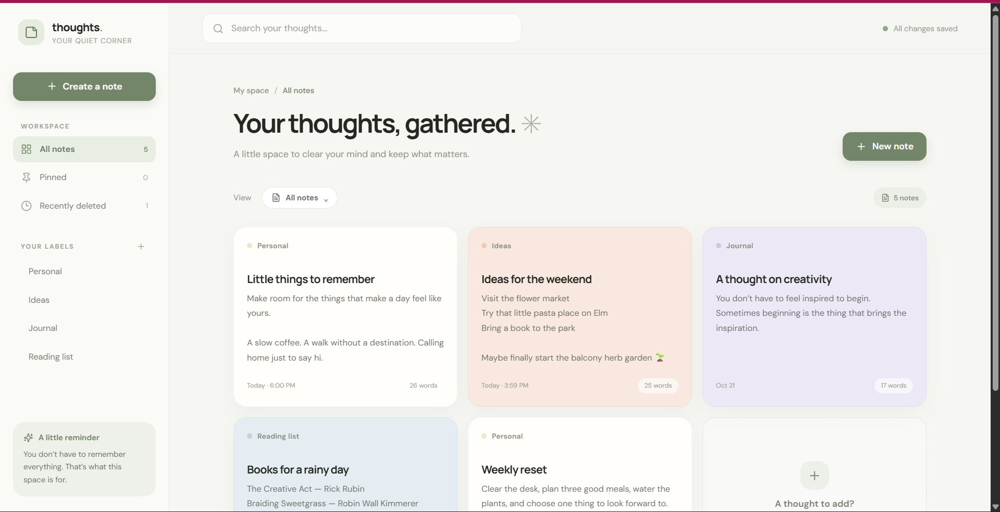

# Thoughts — Notes App

A responsive notes app built with React, JavaScript, Tailwind CSS, and Vite. Create, edit, pin, search, filter, and delete notes. Notes are saved in your browser with `localStorage`.

## Features

- Create and edit notes with categories and color choices
- Search note titles, content, and labels
- Filter by label or pinned notes
- Move notes to Recently deleted, restore them, or delete them permanently
- Responsive layout with subtle animations
- Automatic saving in browser `localStorage`

## Home page preview




## Project structure

```text
src/
  components/
    EmptyState.jsx   Empty search and filter views
    NavItem.jsx      Reusable sidebar navigation item
    NoteCard.jsx     Note preview and note actions
    NoteEditor.jsx   Create and edit note dialog
    Sidebar.jsx      Workspace navigation and labels
    TopBar.jsx       Search and mobile actions
  data/
    notes.js         Starter notes, storage keys, and color options
  utils/
    notes.js         Local storage, dates, and word-count helpers
  App.jsx            App state and feature composition
  index.css          Tailwind layers and global animation styles
  main.jsx           React entry point
```

## Run locally

1. Install [Node.js](https://nodejs.org/) if it is not already installed.
2. Open a terminal in this `notes-app` folder.
3. Install dependencies: `npm install`
4. Start the development server: `npm run dev`
5. Open the local URL printed by Vite, usually `http://localhost:5173`.

